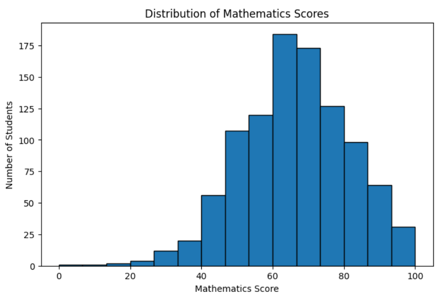
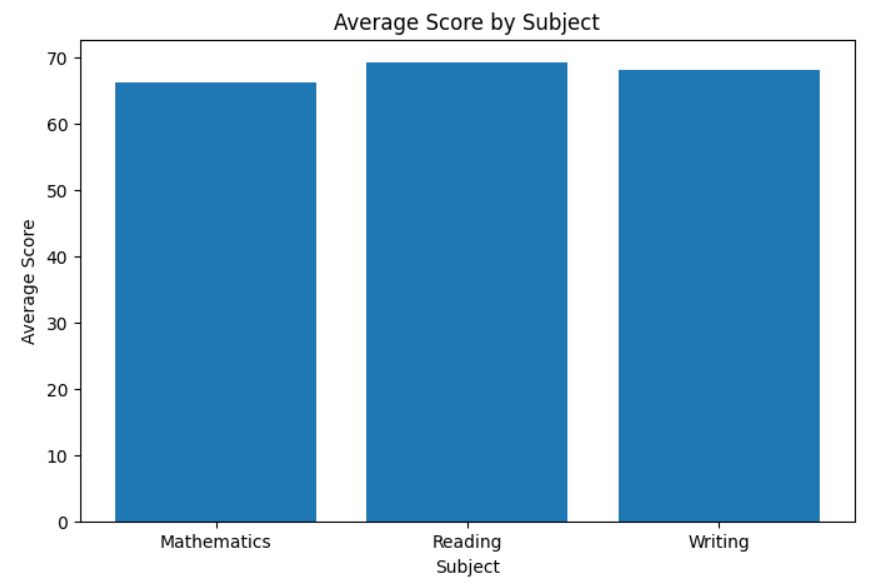
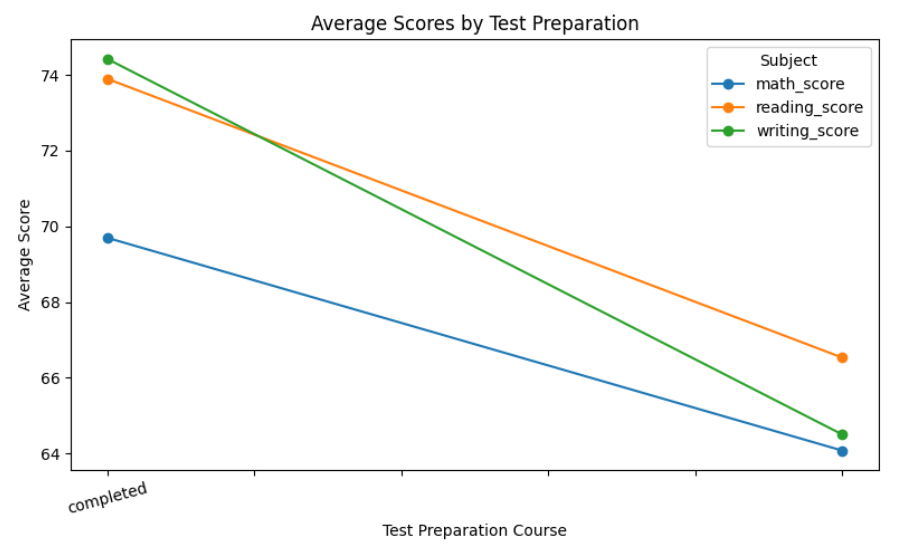
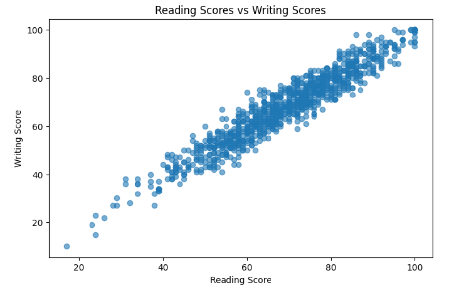
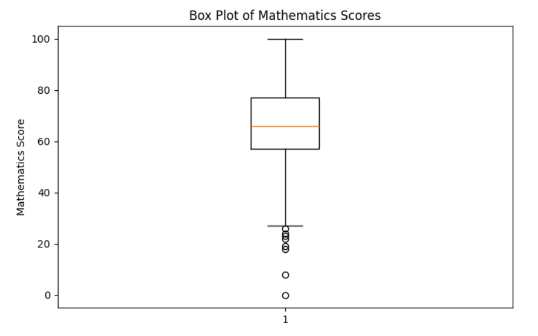
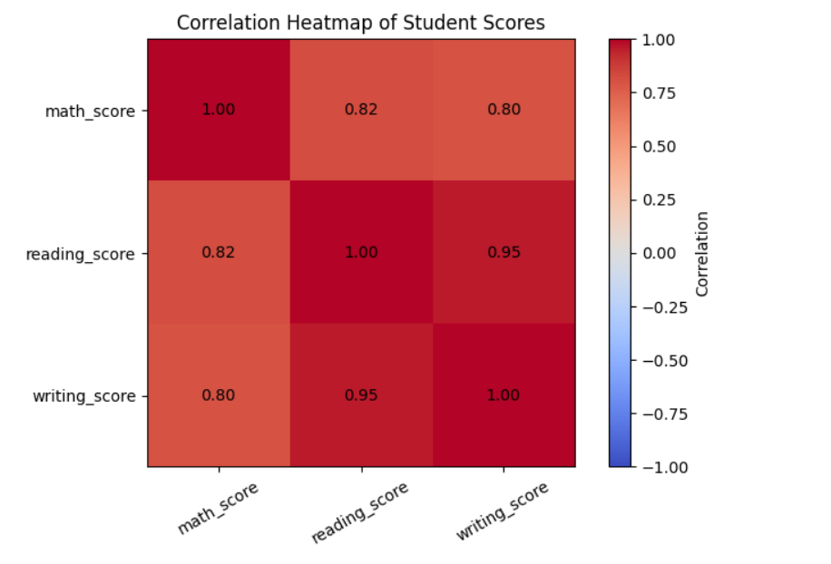
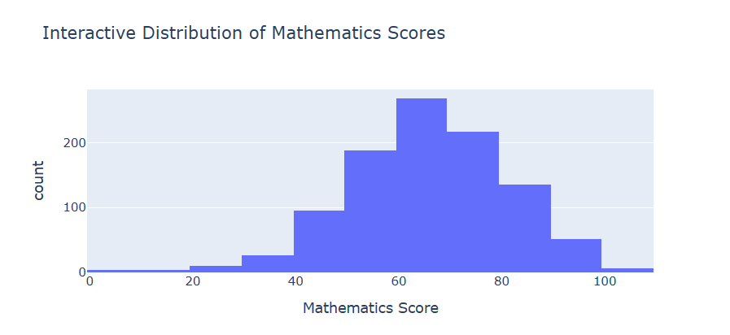
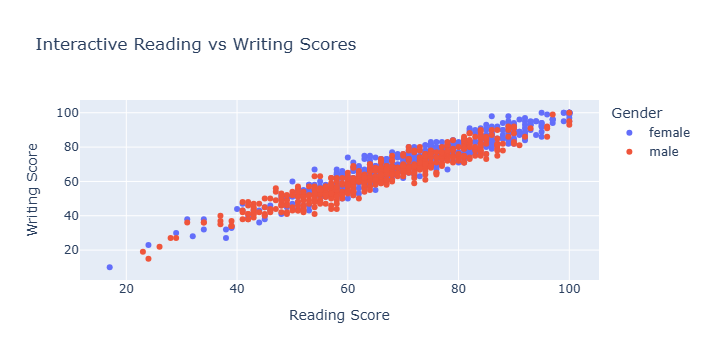
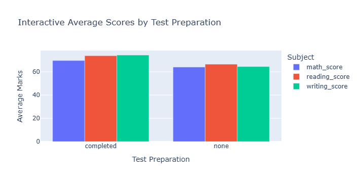

# Student Performance Analysis Using Python

## 1. Project Description

This project analyzes student examination scores using Python.

It includes data preprocessing, exploratory data analysis, visualizations, and feature engineering.

## 2. Dataset

**Dataset Name:** Students Performance in Exams

**Source:** [Kaggle - Students Performance in Exams](https://www.kaggle.com/datasets/spscientist/students-performance-in-exams)

The dataset contains student information and mathematics, reading, and writing examination scores.

## 3. Libraries Used

- NumPy
- Pandas
- Matplotlib
- Plotly
- Scikit-learn

## 4. Project Steps

1. Dataset collection
2. Data loading and inspection
3. Data cleaning and preprocessing
4. Exploratory Data Analysis (EDA)
5. Matplotlib visualizations
6. Interactive Plotly visualizations
7. Feature engineering
8. Results and conclusion

## 5. Matplotlib Visualizations

### 5.1 Histogram of Mathematics Scores

This histogram shows the distribution of mathematics scores among students.

### 5.2 Bar Chart of Average Scores by Subject

This chart compares the average scores in mathematics, reading, and writing.

### 5.3 Line Chart of Average Scores by Test Preparation

This chart compares average subject scores according to test preparation status.

### 5.4 Scatter Plot of Reading vs Writing Scores

This chart shows the relationship between reading and writing scores.

### 5.5 Box Plot of Mathematics Scores

This box plot shows the median, spread, and possible outliers in mathematics scores.

### 5.6 Correlation Heatmap

This heatmap shows the correlation between mathematics, reading, and writing scores.

## 6. Interactive Plotly Visualizations

### 6.1 Interactive Histogram of Mathematics Scores

This chart provides an interactive view of mathematics score distribution.

### 6.2 Interactive Scatter Plot of Reading vs Writing Scores

This chart explores the relationship between reading and writing scores.

### 6.3 Interactive Bar Chart of Average Scores by Test Preparation

This chart compares average subject scores for students who completed or did not complete the test preparation course.

**Note:** The images above are static previews. The interactive Plotly charts can be explored in the Jupyter Notebook.

## 7. Feature Engineering

Feature engineering was performed to create meaningful features from the existing dataset.

## 8. Results and Conclusion

The project helps understand student examination performance through data analysis and visualization.

The visualizations help identify patterns, score distributions, and relationships between different subjects.

Refer to the Jupyter Notebook for detailed numerical results and EDA observations.

## 9. How to Run

1. Install Python and Jupyter Notebook.
2. Install the required packages using:

   `pip install -r requirements.txt`

3. Download the dataset from Kaggle.
4. Place the CSV file in the project folder.
5. Open `Student_Performance_Analysis.ipynb`.
6. Run the notebook cells in order.

## 10. License

Refer to the dataset's Kaggle license and terms before redistributing the dataset.
